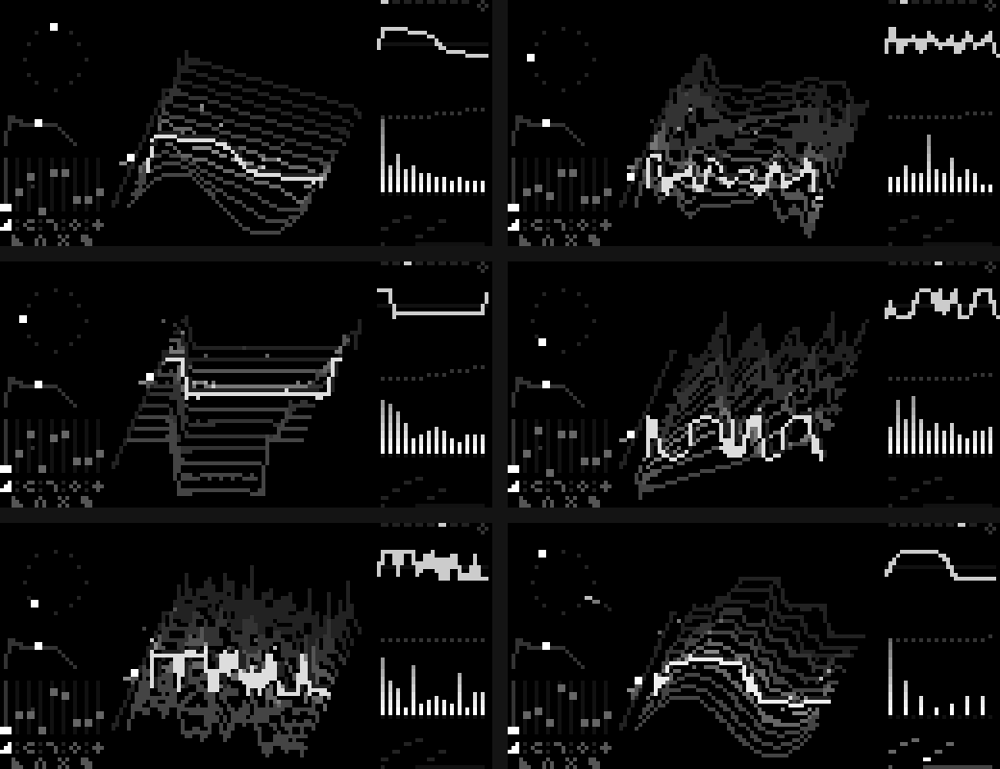
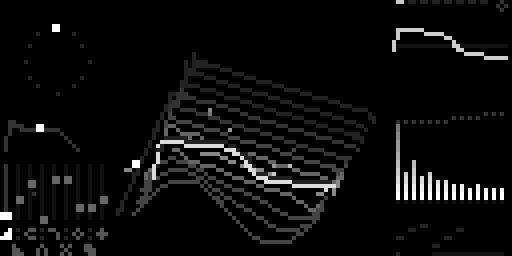
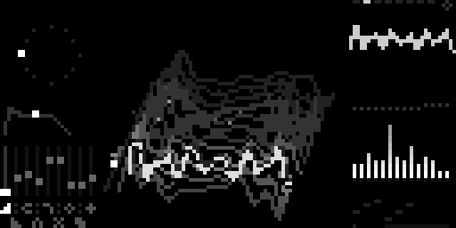
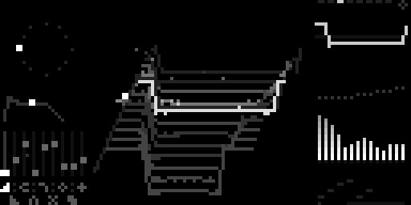
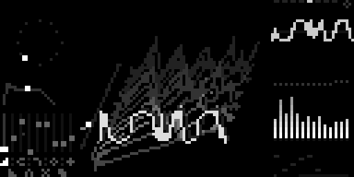
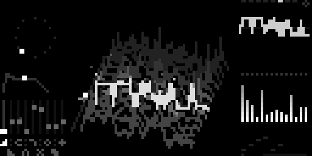
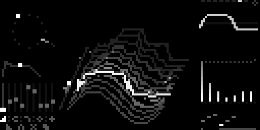

[English](README.md) · [Español](README.es.md) · [Français](README.fr.md) · [Deutsch](README.de.md) · [日本語](README.ja.md) · [中文](README.zh.md) · **हिन्दी**

# Chordex WT

[monome norns](https://monome.org/docs/norns/) के लिए वेवटेबल कॉर्ड वाद्य। एक बटन चार नोट का कॉर्ड और साथ में बेस बजाता है (दबाया गया सबसे नीचा बटन मूल स्वर तय करता है), एक वेवटेबल इंजन के ज़रिए: 8 वेव वाले 8 बैंक, जिनमें आवाज़ लाइव घूमती है।



**स्क्रीन ही टेबल है**, जिसे उसी सूत्र से बनाया गया है जिससे ध्वनि बनती है:

- **बीच में:** 3D में वेवटेबल, आगे (स्थिति 0) से पीछे (स्थिति 1) तक। चमकती वेव वही है जो अभी बज रही है: वह E1, स्वीप और स्कैन के साथ टेबल में चलती है, और फ़िल्टर, warp और drive से गुज़र चुकी होती है। धुंधली परछाईं fatness है, चिंगारियाँ shimmer और चटकन हैं, और आर्पेजियो का हर नोट धूमकेतु की तरह वेव पर दौड़ता है। किनारे पर स्थिति की पटरी (निशान = E1, बिंदु = अभी की स्थिति)।
- **बाएँ:** 12 नोट के चक्र पर कॉर्ड, एनवेलप और 9 फ़ेडर।
- **दाएँ:** ऑसिलोस्कोप (एक चक्र), फ़िल्टर वक्र के साथ स्पेक्ट्रम, और नीचे आर्पेजियो पैटर्न।

## विशेषताएँ

- **8 वेवटेबल बैंक**: CRISTAL (क्रिस्टल), VOCAL, DIGITAL, ORGANO (ऑर्गन), SYNC, METAL, BITS, RESO
- **स्वीप** (हर नोट टेबल में खिसकी हुई जगह से शुरू होकर वापस आता है), **स्कैन** (स्थिति पर LFO), फ़िल्टर और **warp** (वेवफ़ोल्डर)
- **10 कॉर्ड**: maj, min, dim, aug, 7, maj7, min7, m7b5, sus2, sus4
- **आर्पेजिएटर**: up, down, up-down, up x2, down x2, random और *arpa* (हार्प); गेट अधिकतम पर असली लेगाटो
- **कॉर्ड मोड** चालू/बंद (बंद = एक नोट) और **होल्ड**
- दो से ज़्यादा बटन दबाने पर पुराने रिकॉर्ड की चटकने की आवाज़
- आर्पेजियो की गति आने वाली MIDI क्लॉक का पालन करती है
- सभी सेटिंग्स अपने आप सेव होती हैं

<!-- u-ma:family -->
## Chordex परिवार

कंट्रोल वही, इंजन अलग। बाकी भी आज़माएँ:

| | |
|---|---|
| <a href="https://github.com/buenosairesfront/chordex80/blob/main/README.hi.md"></a> | **[Chordex 80](https://github.com/buenosairesfront/chordex80/blob/main/README.hi.md)**<br>outrun सूर्यास्त वाला 80 के दशक का पॉलीसिंथ<br>`;install https://github.com/buenosairesfront/chordex80` |
| <a href="https://github.com/buenosairesfront/chordexfm/blob/main/README.hi.md"></a> | **[Chordex FM](https://github.com/buenosairesfront/chordexfm/blob/main/README.hi.md)**<br>4-ऑपरेटर FM, फूल के रूप में<br>`;install https://github.com/buenosairesfront/chordexfm` |
| <a href="https://github.com/buenosairesfront/chordexstg/blob/main/README.hi.md"></a> | **[ChordexSTG](https://github.com/buenosairesfront/chordexstg/blob/main/README.hi.md)**<br>गज़ से बजे तार की असली गति वाले ऑर्केस्ट्रा स्ट्रिंग्स<br>`;install https://github.com/buenosairesfront/chordexstg` |

**U-MA से और:** सभी वाद्य और टूल एक जगह → [U-MA शोकेस](https://github.com/buenosairesfront/U-ma/blob/main/README.hi.md)
<!-- /u-ma:family -->

## ज़रूरतें

- norns (shield, standard या fates)
- MIDI कीबोर्ड या कंट्रोलर

## इंस्टॉल

maiden में:

```
;install https://github.com/buenosairesfront/chordexwt
```

फिर नया इंजन `ChordexWT` कंपाइल होने के लिए **norns को रीस्टार्ट करें** (SYSTEM > RESTART), और SELECT से **chordexwt** लोड करें।

## कंट्रोल

| कंट्रोल | काम |
|---|---|
| E1 | टेबल में स्थिति |
| E2 | फ़ेडर चुनें |
| E3 | फ़ेडर समायोजित करें |
| K3 + E1 | बैंक |
| K3 + E2 | warp (वेवफ़ोल्डर) |
| K3 + E3 | कॉर्ड का प्रकार |
| K3 दबाए रखें (बिना घुमाए) | कॉर्ड मोड चालू/बंद |
| K2 (टैप) | आर्पेजिएटर चालू/बंद |
| K2 + E1 | आर्पेजियो गेट (अधिकतम = लेगाटो) |
| K2 + E2 | आर्पेजियो पैटर्न |
| K2 + E3 | आर्पेजियो गति |
| K1 दबाए रखें | होल्ड चालू/बंद (ऊपर दाएँ छोटा बिंदु) |

**फ़ेडर:** अटैक, डिके, स्वीप, स्कैन, फ़िल्टर, डिस्टॉर्शन, wobble, fatness, shimmer।

**PARAMETERS मेनू:** MIDI चैनल (0 = सभी, डिफ़ॉल्ट), MIDI क्लॉक डिवाइडर, हॉल, वॉल्यूम, और ऊपर का सब कुछ।

## गैलरी

| | |
|---|---|
|  CRISTAL · maj7 |  VOCAL · min7 |
|  DIGITAL |  SYNC · warp |
|  METAL |  BITS · आर्पेजियो |

## श्रेय

[Buenos Aires Front](https://github.com/buenosairesfront) / U-MA द्वारा बनाया गया।
MIT लाइसेंस।
